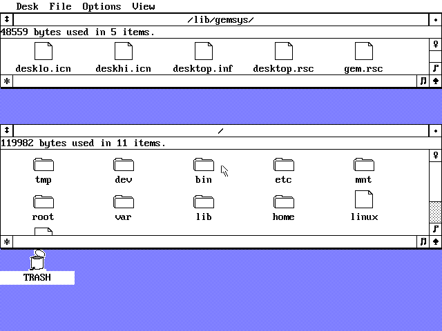
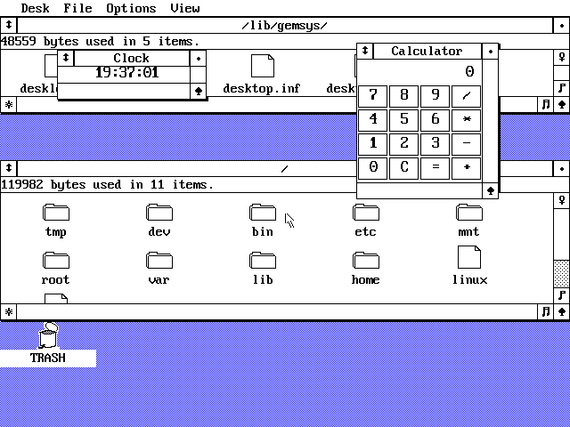
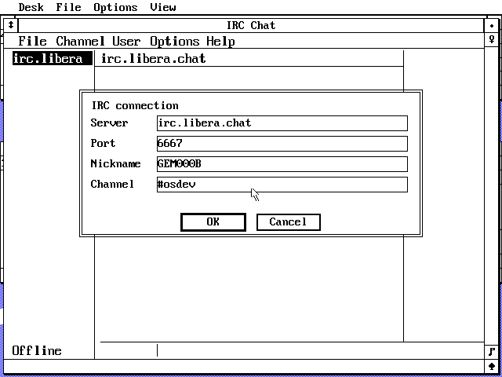

# GEM for ELKS

FreeGEM/OpenGEM Desktop running natively on ELKS for 8086 and 8088 systems.
It runs Desktop and up to four GEM applications at the same time.

No ELKS patch is needed.

## Screenshots

### Desktop



### Clock and Calculator



### Antler IRC



## ELKS services

GEM uses stock ELKS interfaces directly:

- `vfork`, `_execve`, `waitpid`, signals, and the ELKS scheduler manage apps.
- ELKS program segments, `malloc`, `_fmemalloc`, and `_fmemfree` manage memory.
- `setitimer` and `SIGALRM` drive AES timers.
- `open`, `read`, `write`, `stat`, `readdir`, and the other ELKS calls handle files.
- AF_UNIX at `/tmp/gem.aes` carries AES and VDI calls.
- AF_INET handles GemView and Antler IRC.
- The PC BIOS font used by the ELKS console is used in place. No font file or
  font copy takes RAM.

GEM only keeps GUI state and one AES channel number per connected client. It
does not contain a scheduler, process table, memory arena, or VFS.

## Build

Build an ELKS ia16 toolchain, then run:

```sh
make -f Makefile.elks ELKS_ROOT=/path/to/elks -j8
```

Stock ELKS already enables `CONFIG_UNIX=y` in the IBM PC configuration.
`CONFIG_INET=y` is needed for GemView and IRC.

Install into an ELKS target tree:

```sh
make -f Makefile.elks ELKS_ROOT=/path/to/elks \
    DESTDIR=/path/to/elks/target install
```

Rebuild the ELKS image, boot it, then run:

```sh
/bin/gem
```

The server starts `/bin/gemdesk`. Programs launched by Desktop stay separate
ELKS processes and run together.

## Configuration

`/etc/gem.conf` holds the video, keyboard and mouse settings. The default is
automatic video detection and a Microsoft serial mouse on COM1:

```ini
GEM_VIDEO=auto
MOUSE_PROTOCOL=ms
MOUSE_PORT=/dev/ttyS0
```

Use `/dev/ttyS1` for COM2, `MOUSE_PROTOCOL=amstrad` for the PC1512/1640 mouse,
or `MOUSE_PROTOCOL=none` to disable the hardware mouse. Keep the mouse port
free of getty and serial-console services. The serial driver sets 1200 baud,
seven data bits, no parity and one stop bit.
Older ELKS 8250 drivers ignore the termios word length, so GEM also sets the
UART framing directly for ttyS0 through ttyS3 and restores it on exit.

`CONSOLE=/dev/tty1` selects the keyboard console. Without it, GEM tries tty1
and then `/dev/console`. `GEM_VIDEO` accepts `auto`, `ega`, `vga`, `cga`,
`herc`, `hercules` and `pega`.

Settings use unquoted `KEY=VALUE` lines. Spaces and `#` comments are allowed;
the file must be smaller than 1024 bytes. Environment variables override the
file. A missing file uses the built-in defaults. Unknown keys, malformed
lines and oversized files stop startup with an error.

The usual GEM Desktop settings stay in `/lib/gemsys/desktop.inf`. Installation
preserves both configuration files when they already exist.

## Programs

- `gemdesk` - OpenGEM Desktop
- `gemclock` - Clock
- `gemcalc` - Calculator
- `gemview` - small HTTP viewer
- `gemirc` - Antler IRC client port

GemIRC can use its connection dialog or command-line values:

```sh
/bin/gemirc server channel nick port
```

Its default is `irc.libera.chat:6667`, channel `#osdev`.

Run the host configuration, serial mouse packet and IRC checks with:

```sh
make -f Makefile.elks check
```

See [BUILDING.txt](BUILDING.txt) and [documentation.txt](documentation.txt) for
the build and source layout.
